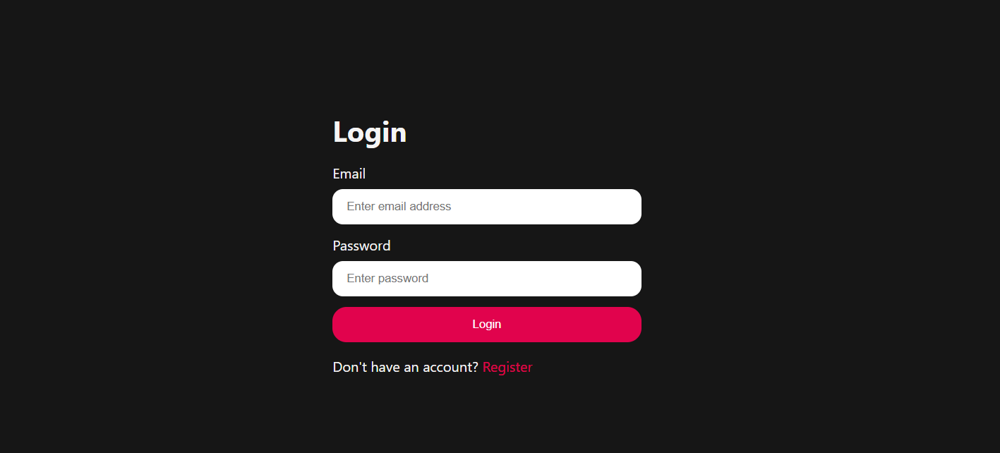
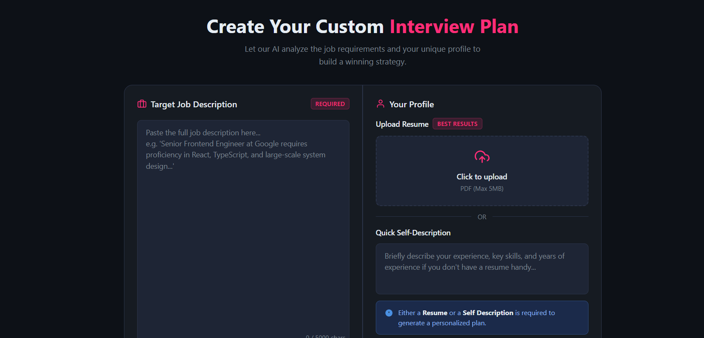
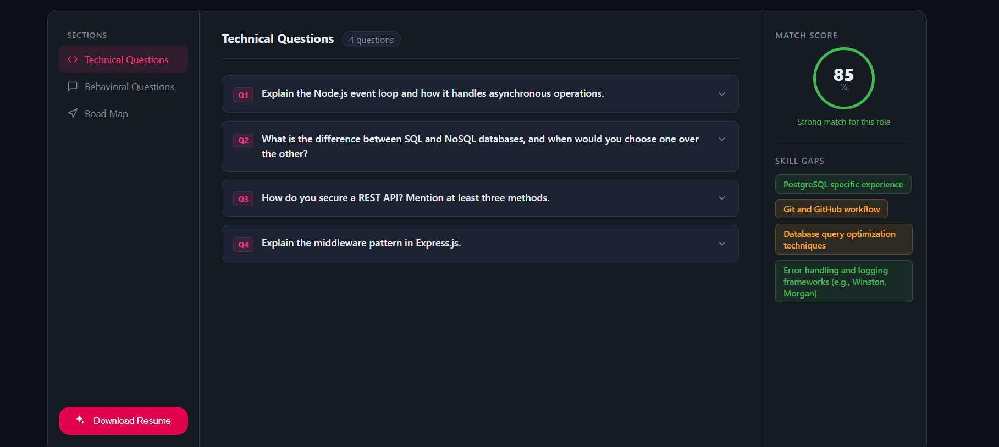
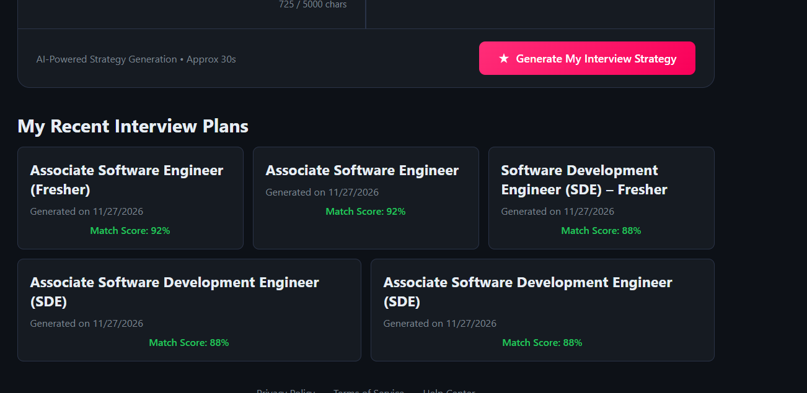

# CareerPilot AI

CareerPilot AI is an AI-powered interview preparation and resume optimization platform designed to help job seekers prepare for interviews based on their skills, experience and target job descriptions.

## Live Demo

[Launch CareerPilot AI](https://career-pilot-ai-mu-smoky.vercel.app)

## Features

- User registration, login and logout with JWT authentication.
- PDF resume upload and text extraction.
- Interview preparation using self-description.
- AI-generated technical and behavioural interview questions.
- Job compatibility match score.
- Skill gap analysis.
- Personalized interview preparation roadmap.
- AI-generated resume with PDF download.
- Access to previous interview reports.
- Responsive dark-themed user interface.

## Technology Stack

### Frontend

- React.js
- Vite
- JavaScript
- SCSS
- React Router
- Axios

### Backend

- Node.js
- Express.js
- MongoDB
- Mongoose
- JWT Authentication
- Multer
- Puppeteer

### Artificial Intelligence

- Google Gemini API
- Zod Schema Validation

### Deployment

- Vercel – Frontend
- Render – Backend
- MongoDB Atlas – Database

## System Architecture

User → React Frontend → Express REST API → Gemini AI / MongoDB

## How It Works

1. The user registers or logs into the platform.
2. The user enters a target job description.
3. The user uploads a resume or provides a self-description.
4. The backend processes the information using Gemini AI.
5. The AI generates a personalized interview preparation report.
6. The report is stored in MongoDB.
7. The user can generate and download an optimized resume in PDF format.

## Project Screenshots

### Login Page



### Home Dashboard



### AI-Generated Interview Report



### Previous Interview Reports



## Local Installation

### Prerequisites

- Node.js and npm
- MongoDB Atlas account
- Google Gemini API key
- Google Chrome or a compatible Puppeteer browser

### Backend Setup

```bash
cd Backend
npm install
```

Create a `.env` file using `.env.example` as a reference.

Start the backend server:

```bash
npm start
```

Backend URL: http://localhost:3000

### Frontend Setup

Open a separate terminal from the project root.

```bash
cd Frontend
npm install
npm run dev
```

Frontend URL: http://localhost:5173

## Environment Variables

Configure the following variables inside `Backend/.env`:

```env
MONGO_URI=your_mongodb_connection_string
JWT_SECRET=your_jwt_secret
GOOGLE_GENAI_API_KEY=your_gemini_api_key
PUPPETEER_EXECUTABLE_PATH=your_chrome_executable_path
FRONTEND_URL=http://localhost:5173
```

Actual credentials must be stored securely and must not be committed to GitHub.

## Project Structure

```text
CareerPilot-AI/
├── Backend/
│   ├── src/
│   ├── .env.example
│   ├── server.js
│   └── package.json
├── Frontend/
│   ├── public/
│   ├── src/
│   ├── vercel.json
│   ├── README.md
│   └── package.json
├── screenshots/
│   ├── login.png
│   ├── home.png
│   ├── reports.png
│   └── previous.png
├── .gitignore
└── README.md
```

## Custom Enhancements

- Personalized project branding.
- Custom website favicon.
- Navigation header and logout functionality.
- Dynamic job description character counter.
- Resume upload validation.
- Optional resume and self-description handling.
- Improved PDF generation.
- Responsive interface improvements.
- Environment configuration and credential protection.
- Frontend and backend error fixes.
- Production deployment configuration.

## Learning Outcomes

- Full-stack application development.
- REST API development and integration.
- Database management.
- User authentication and authorization.
- Generative AI integration.
- File handling and PDF generation.
- Application debugging and error handling.
- Git and GitHub version control.
- Cloud application deployment.

## Future Enhancements

- Interactive AI mock interviews.
- Interview performance analytics.
- Resume version management.
- Downloadable interview preparation reports.

## Deployment Note

The backend is hosted on Render's free tier. The initial request may take longer after a period of inactivity.
